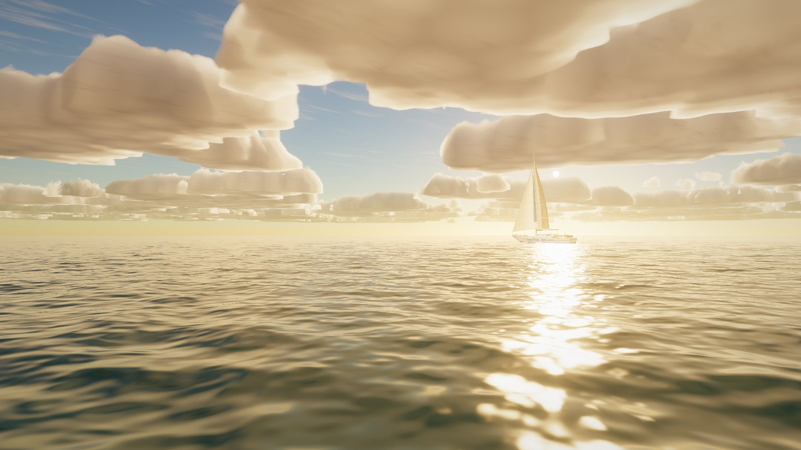
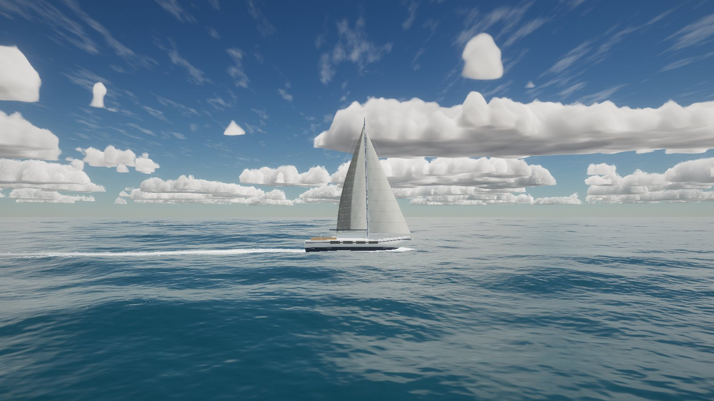
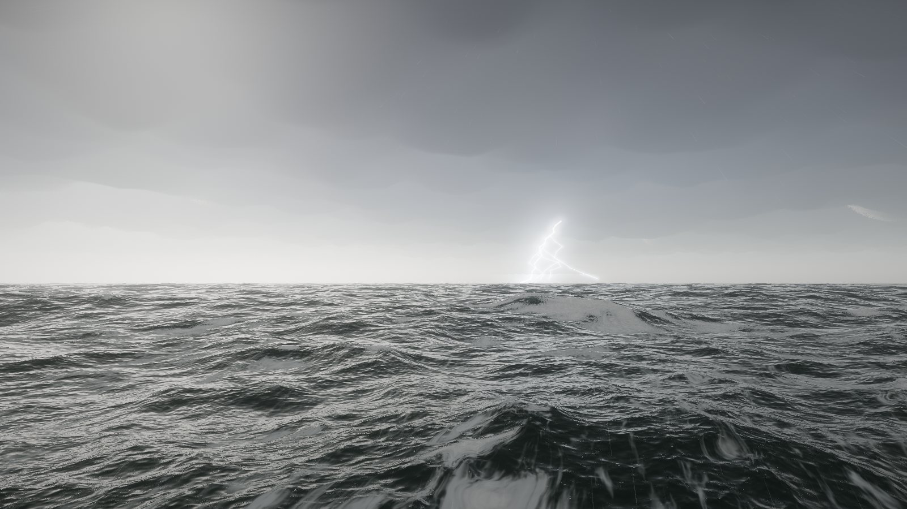
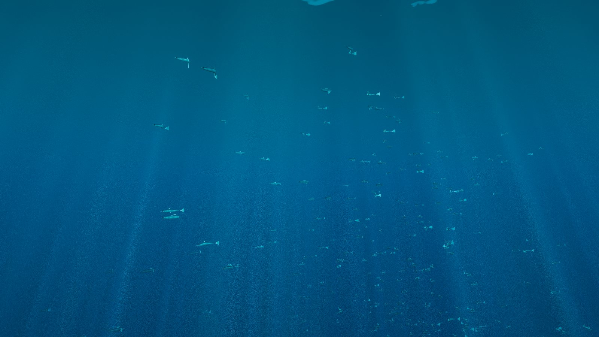
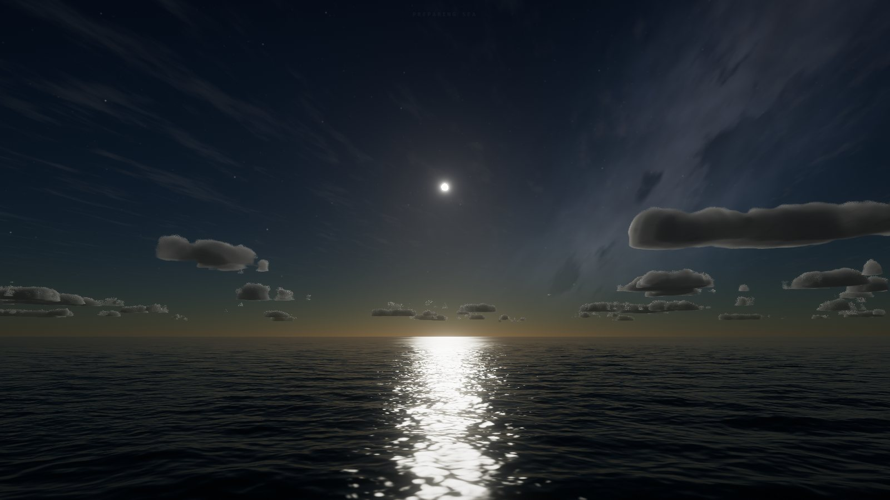
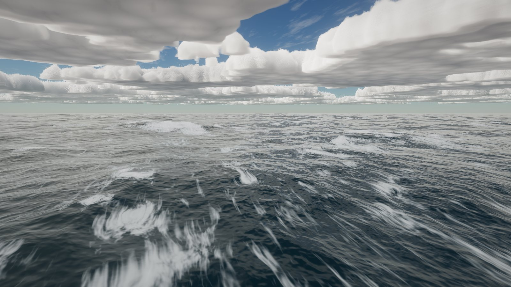

# Open Sea

Real-time 3D ocean in the browser (WebGL2, no dependencies).

Open `open-sea.html` (single file, works from `file://`) or serve the folder and open `index.html`.
Needs WebGL2 with float render targets (any current desktop Chrome / Edge / Firefox / Safari on a discrete or recent integrated GPU).

## What is simulated

- **Waves**: GPU FFT ocean (Tessendorf), 4 cascades (1500 / 380 / 95 / 24 m tiles, 256² each), JONSWAP spectrum normalised to the target significant wave height of each Beaufort force, plus a swell component, capillary dispersion, choppy (horizontal) displacement.
- **Foam**: fold (Jacobian) detection on the large cascades feeds a persistent, world-anchored foam field; shading uses warped anisotropic noise so foam tears into streaks and lace instead of round blobs. Coverage per sea state is calibrated (`tools/calib.js`).
- **Sky**: single-scatter atmosphere with ozone and planet shadow, transmittance + sky-view LUTs, sun, moon (real phase from the sun direction), stars, Milky Way; exposure adapts across a 10⁵ luminance range.
- **Clouds**: raymarched volumetric layer (Perlin-Worley noise volume), the same density function casts cloud shadows on the sea and yacht.
- **Water shading**: exact Fresnel, roughness from the unresolved slope variance (mip-filtered slope moments), analytic sun/moon glitter, subsurface colour, aerial perspective.
- **Yacht**: procedural sloop with buoyancy from GPU wave probes, sails that trim to the apparent wind, luff/flutter, shadow map, wake (wave-equation ripple field with fixed timestep + foam trail).
- **Underwater**: spectral absorption, sun shafts computed from the real wave slopes (refraction focusing), Snell's window, fish schools.
- **Weather**: rain (streaks + analytic ring ripples), lightning (fractal bolts, flash timeline, cloud illumination, reflection in the sea).

## Controls

Tour plays first (any input takes control). WASD move, Q/E down/up, drag to look, Shift fast, wheel = speed, H hides the panel, T toggles the tour.
Panel: Sea (Beaufort 0–12), Time, Cloud, Rain, Strike; Tour, Dive, Yacht, Calm / Night / Storm presets, Quality (Auto / Low / Ultra).

## Dev tooling

`tools/serve.js` static server, `tools/shot.js` headless-Chrome capture (URL params: `sea hour clouds rain lightning cam=x,y,z,yaw,pitch tour=<s> look=sun|moon at=yacht ...`), `tools/pack.sh` review stills, `tools/build.js` → `open-sea.html`.

## Gallery

Stills captured from the renderer itself (headless Chrome, Intel Iris Xe). See `docs/`.

| | |
|---|---|
|  |  |
|  |  |
|  |  |

## Honest status

An independent, deliberately harsh image review scored the stills about 3/10 for "could pass as a photograph". The sea surface, sun/moon glitter and storm seas hold up best. The known weak spots are cumulus clouds (sticker-like, speckled edges), the yacht (toy-like up close, weak bow wave), fish (small cut-outs) and a visible ripple lattice in glassy water.
Tested on an Intel Iris Xe at roughly 30-40 fps (auto quality); not tested on other GPUs, touch devices, or with audio (there is none).

## Regenerating stills

```
node tools/serve.js            # http://localhost:8137
node tools/shot.js name "sea=7&hour=14&clouds=0.6&cam=0,7,0,220,-6&warm=25&yacht=0"
node tools/build.js            # rebuild open-sea.html
```
`tools/shot.js` expects Chrome at `C:/Program Files/Google/Chrome/Application/chrome.exe` and Node 22.
